<div align="center">

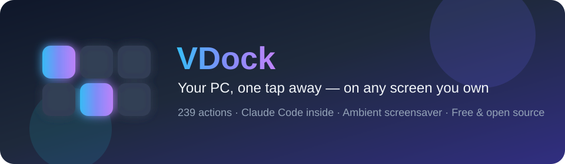

### Your development wingman, on any screen you already own.

**VDock sits next to your editor and keeps your AI agents, your repo and your day moving. It tells you the moment Claude Code, Cursor or Codex needs you, and lets you approve, prompt, review and ship from one tap on a touch panel, tablet, phone or browser tab. Free, open source, and 100% local.**

https://github.com/user-attachments/assets/fd467aec-f5a0-4614-b37c-757e29974d23

<sub>Click the preview to watch the full video</sub>

[](LICENSE)
[](https://github.com/ponya5/VDock/releases/latest)
[](#-install-in-1-minute)
[](#-join-the-community)

<table>
<tr>
<td align="center"><a href="#-why-vdock"><b>Why VDock</b></a></td>
<td align="center"><a href="#-what-only-vdock-does"><b>Only in VDock</b></a></td>
<td align="center"><a href="#-any-screen-is-a-deck"><b>Any screen</b></a></td>
<td align="center"><a href="#-a-dashboard-you-design"><b>Your design</b></a></td>
<td align="center"><a href="#-an-interactive-screensaver"><b>Screensaver</b></a></td>
<td align="center"><a href="#-install-in-1-minute"><b>Install</b></a></td>
<td align="center"><a href="#-join-the-community"><b>Contribute</b></a></td>
</tr>
</table>

</div>

---

## 👋 Why VDock

Coding with AI agents changed the job. The agent works, then it **waits** for a permission, an answer, a "continue". Meanwhile you're in another window, the build is red, and you only find out ten minutes later.

**VDock is your wingman for that loop.** It's a deck of buttons and live tiles that runs beside your editor on a spare screen: a cheap USB touch panel, an old tablet, your phone, or a browser tab. No vendor hardware, no account, no subscription.

<div align="center">
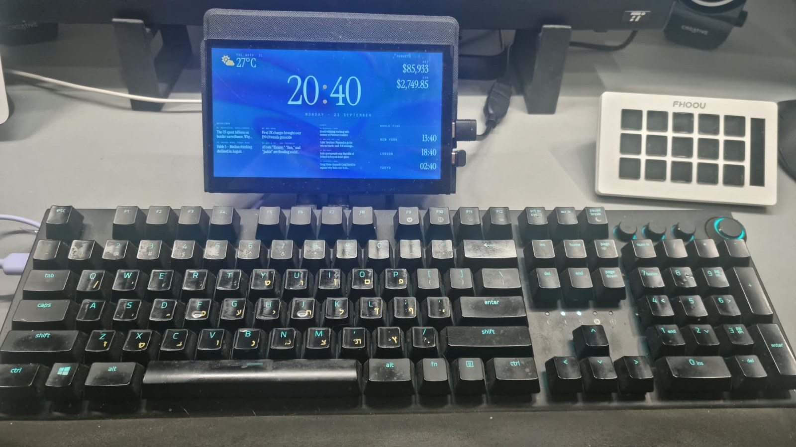
<br /><em>A 7-inch panel above the keyboard.</em>
</div>

|  |  |
|---|---|
| **It reacts to your apps** | Knows when an agent is working or waiting, and switches scenes to match the app you're in. |
| **Any screen is a deck** | Phone, tablet, touch panel or browser, all from the same QR code. |
| **Yours to design** | Lay out every scene, key, background and font yourself. |
| **Ready out of the box** | Claude Code, Cursor, Copilot, Codex, Devin, VS Code, JetBrains, OBS, GitHub and more. |
| **Alive when idle** | Four screensavers: Wingy the robot buddy, an ambient dashboard, a music spectrum visualizer and live system stats. |
| **Local and private** | Everything runs on your PC. No cloud, no telemetry. |

---

## ⚡ What only VDock does

Plenty of tools give you buttons. VDock is different: it **watches your AI agents and your repo, and meets you there**.

| | |
|---|---|
| 🔔 **Knows when your agent needs you** | A branded full-screen alert on your deck *and* your phone the moment Claude Code, Cursor, Copilot, Codex or Devin waits for you. |
| ✅ **Approve from the couch** | Approve, deny or answer from your phone. Input goes into your **live** session, not a new one. |
| 🔀 **Scenes follow your work** | Open Cursor and the Cursor scene appears. Jump to your terminal and Claude Code takes over. |
| 🧭 **Mission Control** | Every agent session in one place: working, waiting, done. |
| 🌙 **A screensaver that keeps working** | Wingy the robot buddy reacts to your agents and your music, the spectrum visualizer dances to whatever's playing, and the dashboard and stats boards stay glanceable. |
| 🏠 **100% local and free** | No cloud, no account, no hardware to buy. MIT licensed. |

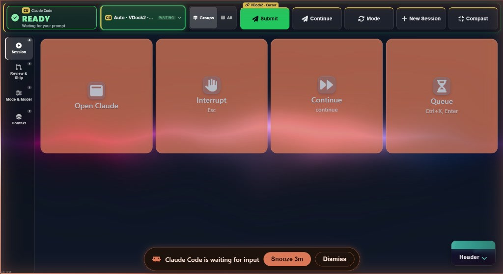

*The Claude Code scene: live session status up top, the session's keys below, and a banner the moment it waits for you.*

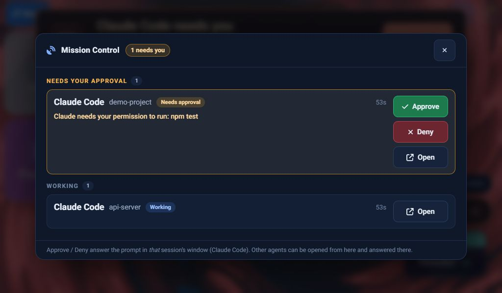

Agents report in through their official hooks. Send a preset prompt ("Continue", "Write tests"), run a slash command, or dictate to the session. Prefer manual scenes? Turn auto-switching off.

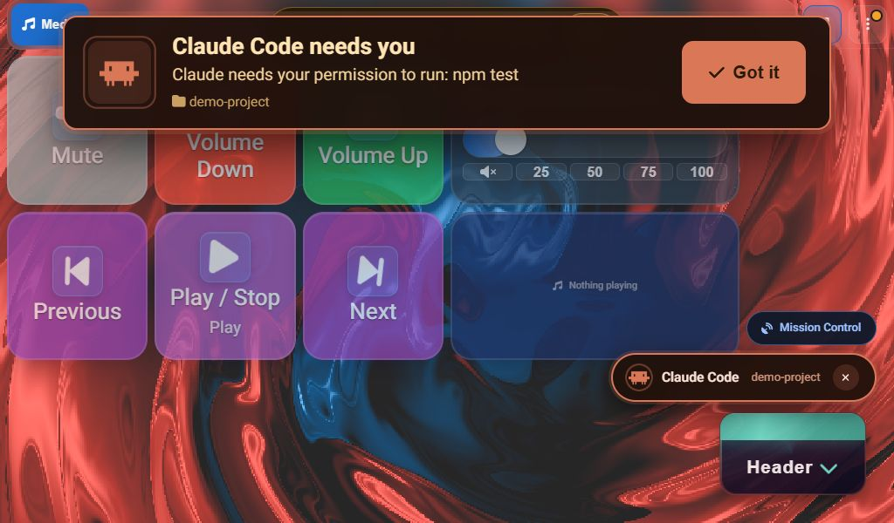

It knows your repo too: branch, changed files and diffs, test runs, dev servers, Docker, PRs and CI checks as live buttons. Keystroke actions only fire when the target app is focused, so keys never land in the wrong window.

---

## 📱 Any screen is a deck

<div align="center">
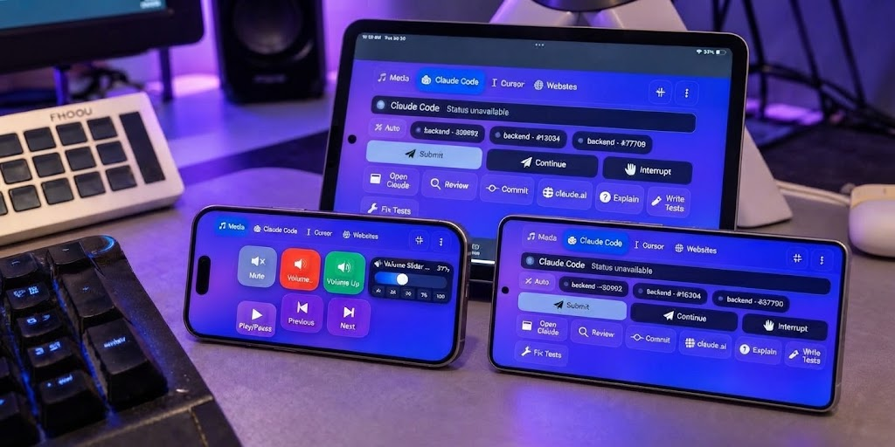
<br /><em>Media on one phone, Claude Code on a phone and a tablet. Same VDock, same QR code.</em>
</div>

**No touchscreen? You probably already own one.** VDock is served from your PC to any browser on your Wi-Fi. No app store, no account.

- **Phone = a remote.** Portrait layout with a Claude Code console and an **approval remote**: approve a waiting agent from the couch.
- **Tablet = a full deck.** Portrait and landscape grids, on-device editing, screen stays awake.
- **Stays in sync.** Reconnects on its own, resumes on the right scene, and edits show up on every device.
- **Install it as an app** on the Home Screen for a full-screen, no-browser-bars deck.

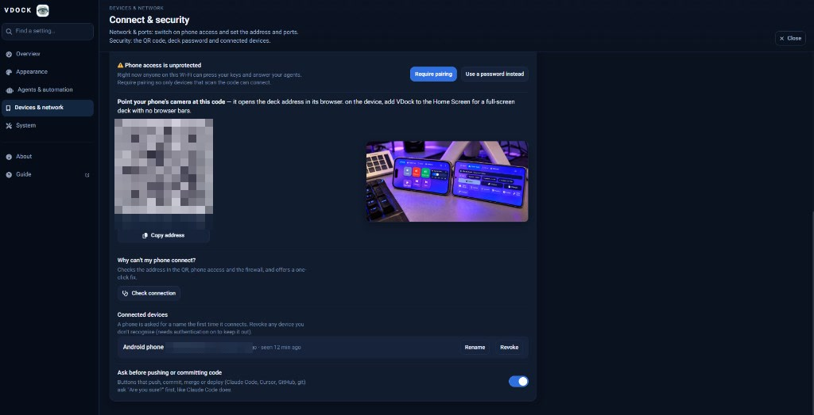

Open **Settings > Devices & network > Connect & security**, turn on **Allow phone & tablet access**, and scan the QR code. **Require pairing** (only devices that scan the code get in) or set a deck password, and **Check connection** walks through the address, phone access and firewall if a phone can't connect. Every phone that joins is listed, so you can rename or revoke it.

🔐 **Secure pairing with no typing.** With **Require pairing** on, the QR code carries a unique, random **one-time pairing token**. Scan it and the phone is in: no password to type, no account. The token works once, expires within minutes (the QR code refreshes itself), and is traded for the phone's own login token, which you can revoke at any time. Scanning an old screenshot of the QR code gets nobody in.

> **Security:** LAN access is off by default. Anyone on your Wi-Fi who can reach the deck can press your keys, so **set a deck password before turning it on**. See [Security](#-security-and-privacy).

---

## 🎨 A dashboard you design

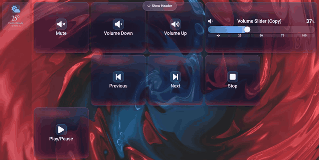

Every scene is a grid you lay out yourself: any size, any mix of buttons, sliders and live widgets. Make it yours with **animated backgrounds** (or your own image), **see-through keys**, **ten key designs**, **sliders** for volume and brightness, and **three fonts**.

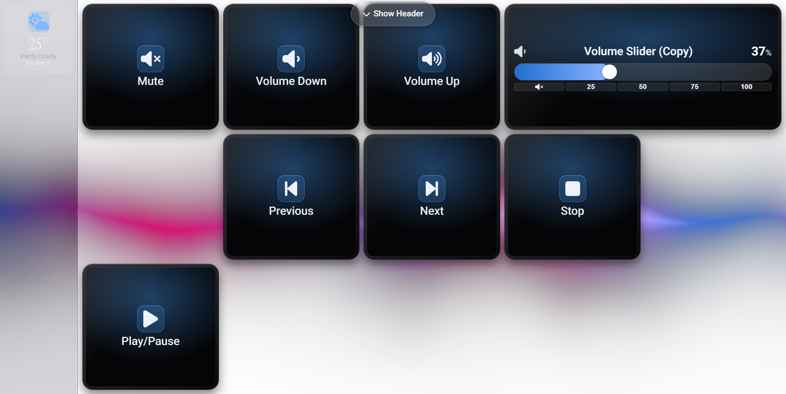

*Same scene, every key switched to the Deck Key design.*

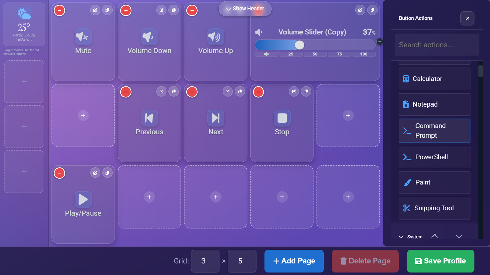

Tap the pencil to edit. Tap a **+** to search every action, drag keys to reorder, resize, add pages, or pin a **docked sidebar** that stays put everywhere. Changes save themselves.

### Popular apps, ready out of the box

Start from an **app template** instead of a blank grid. Scenes for Claude Code, Claude Cowork, Cursor, VS Code, JetBrains, GitHub, OBS, ChatGPT, Figma, n8n and dozens more come with sensible buttons, or import a scene pack someone shared. Beyond apps, VDock has built-in actions for hotkeys, media, system controls, webhooks and anything with an HTTP endpoint (Home Assistant, Zapier).

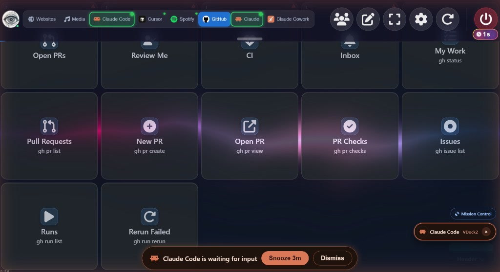

*One scene per app in the top bar. The GitHub scene runs `gh` for PRs, checks and reruns.*

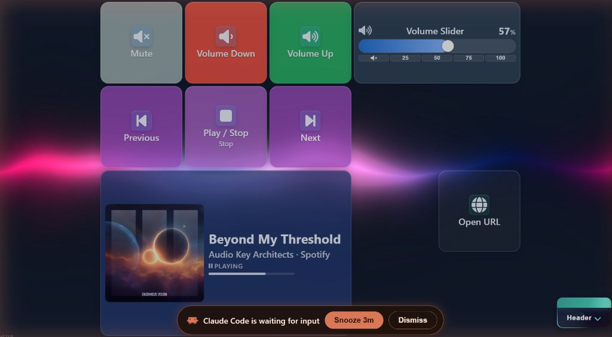

*The Media scene with a live Now Playing card for whatever's playing on the PC.*

---

## ✨ An interactive screensaver

When the deck is idle it comes alive. Pick one of four screensavers, or shuffle through them all.

<div align="center">
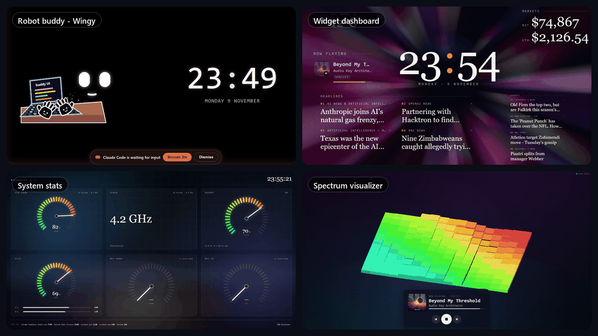
</div>

| Screensaver | What it shows |
|---|---|
| 🤖 **Robot buddy** | Wingy and a big clock. Wingy shows what your PC is doing: coding agents, music, load, time of day. |
| 📰 **Widget dashboard** | Clock, weather, news and sports headlines, stock and crypto quotes, and world clocks. Drag and resize every widget. |
| 🎵 **Spectrum visualizer** | 16 skins, from Winamp bars to Iso Field and Neon Flight, moving with the music itself, not your volume knob. Switch skins with the arrows in the corner. |
| 📊 **System stats** | Full-screen CPU, memory, disk and network gauges plus the busiest processes. |

Choose one in **Settings > Appearance > Screen saver**. **Test** shows it right away. If an agent needs you while the screensaver is up, the alert appears on top of it.

### Meet Wingy

<div align="center">
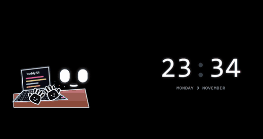
</div>

**Wingy** is a robot buddy that shares the screen with a big clock and shows what your PC is up to:

<table>
<tr>
<td width="50%">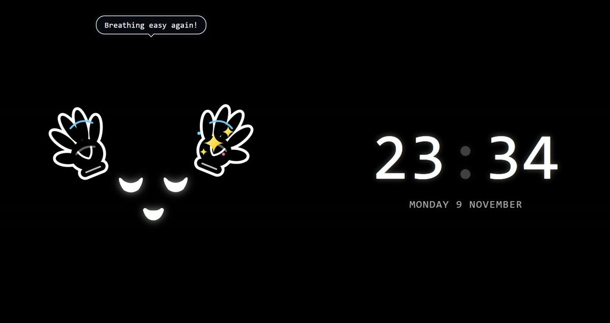</td>
<td width="50%">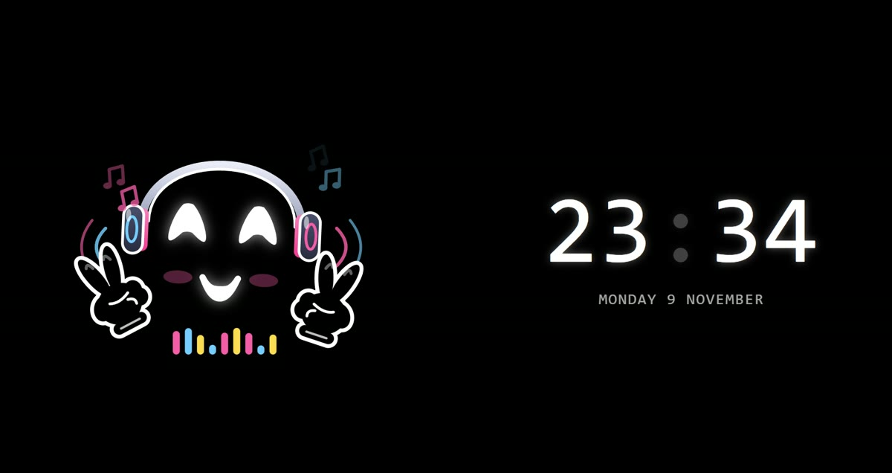</td>
</tr>
<tr>
<td align="center"><em>Your agent is coding</em></td>
<td align="center"><em>Music is playing</em></td>
</tr>
</table>

- **Coding agents:** types along while Claude Code or Cursor works, waves a phone at you when the agent is waiting, and puts on a party hat with a trophy when it's done.
- **Music:** headphones on and dancing while something plays.
- **System load:** sweats through CPU spikes and complains about a low battery.
- **Time and weather:** morning coffee, sleepy nights, sunglasses on sunny days.
- **Poke it:** its eyes follow your finger or mouse. Tickle its mouth and it giggles, circle around it and it gets dizzy, linger and it turns shy.
- **Pick a personality:** Funny, Grumpy, Sarcastic, Sweet, or a random one each day, with optional speech bubbles.

Turn it on in **Settings > Appearance > Screen saver** by choosing **Robot buddy**. You can choose which side Wingy sits on and switch each kind of reaction on or off.

### Ambient dashboard, music spectrum and system stats

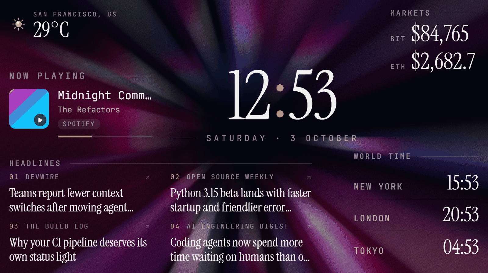

- **Ambient dashboard:** clock, weather, news and sports headlines, stock and crypto quotes, and world clocks. No API keys required. Toggle each widget and drag-and-resize the layout.
- **Music spectrum:** 16 animated skins that react to whatever's playing on the PC. The bars follow the music's own shape and dynamics, so turning the volume up or down doesn't change them. Step through skins with the **‹ ›** buttons in the top-left corner without waking the deck, shuffle them on a timer, and keep a Now Playing card with media controls on top.
- **System stats:** a full-screen sensor board of CPU, memory, disk and network gauges, with the busiest processes along the bottom.
- **Shuffle:** rotate through all four screensavers while the deck is idle.

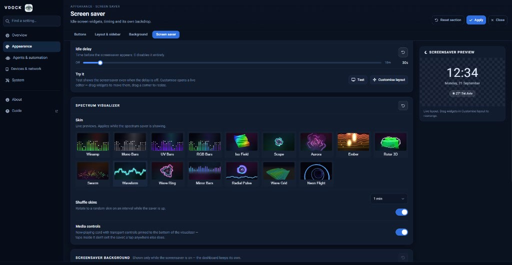

*Screen saver settings: the spectrum skins, shuffle and a live preview.*

---

## ⚙️ Settings that stay out of your way

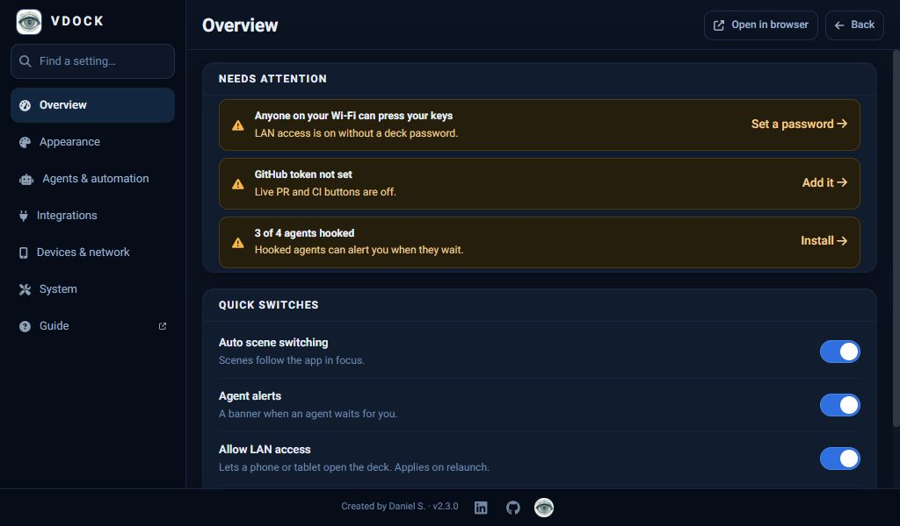

Settings opens on an **Overview** of what's set up and what needs attention. It's searchable and saves as you go.

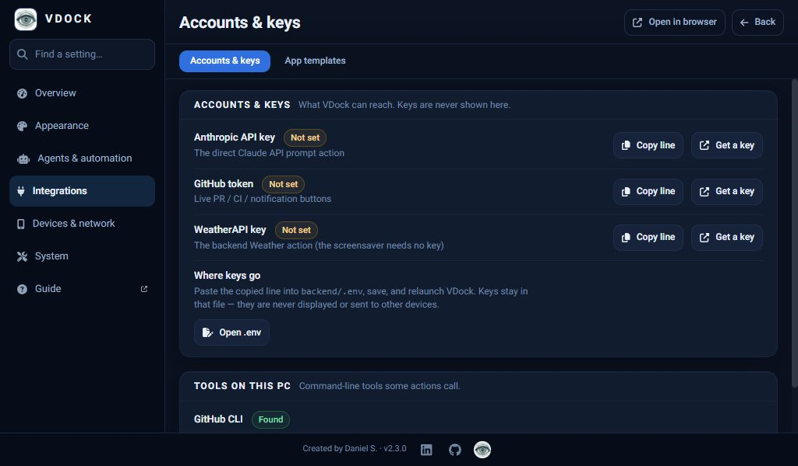

**Accounts & keys** shows what's configured and what each key unlocks. Keys are saved to a local `.env`, accepted only from the PC itself, and never shown again or sent to other devices.

---

## 🔒 Security and privacy

VDock can press keys and type into your terminal, so trust matters. **Everything runs on your own machine.**

- **No cloud, no account, no telemetry.** Your prompts, repo details and session activity never leave your PC.
- **Locked down by default.** LAN access is off until you turn it on. Phones pair by scanning a QR code that carries a unique, single-use pairing token (it expires after 3 minutes and the code refreshes itself). Each phone then gets its own revocable login token, and repeated pairing attempts are rate-limited.
- **Agents report in locally**, through their official hooks to a localhost-only endpoint. You install or remove each hook from Settings, and only VDock's own entry is touched.
- **Works offline.** Only the optional screensaver feeds and GitHub (when you add a token) use the network.
- **Open source (MIT).** Startup refuses unsafe combinations. See [SECURITY.md](SECURITY.md).

---

## 🚀 Install in 1 minute

**You need:** a Windows, macOS or Linux PC, and a screen to use as the deck (optional: the PC screen works too).

### Step 1. Download

Grab the installer for your OS from the **[latest release](https://github.com/ponya5/VDock/releases/latest)** (Windows `.exe`, macOS `.dmg`, Linux `.AppImage` / `.deb`) and run it.

> The builds aren't code-signed with a paid certificate yet, so your OS warns once:
> - **Windows:** choose **More info > Run anyway**.
> - **macOS:** open the app, click **Done**, then **System Settings > Privacy & Security > Open Anyway**. If that button is missing, run `xattr -dr com.apple.quarantine /Applications/VDock.app`.

### Step 2. Open VDock

Launch it from the Start menu, Launchpad or desktop icon. A short tour drops you into working **Media** and **Claude Code** scenes with no configuration.

### Step 3. Add your phone or tablet (optional)

Go to **Settings > Devices & network > Connect & security**, turn on **Allow phone & tablet access**, choose **Require pairing** or set a deck password, and scan the QR code.

<details>
<summary><strong>Prefer to build from source?</strong></summary>

You need [Python 3.10–3.14](https://www.python.org/downloads/) (3.13 recommended) and [Node.js 20+](https://nodejs.org/):

```bash
git clone https://github.com/ponya5/VDock.git
cd VDock
```

- **Windows:** double-click **`setup.bat`**
- **macOS / Linux:** `./setup.sh`

Press **Enter** for the recommended full setup. It finds a supported Python, installs dependencies, picks free ports and adds VDock to your apps.

</details>

**Optional tools** unlock extra actions (buttons stay greyed out with the reason until installed): [Claude Code](https://claude.com/product/claude-code), [GitHub CLI](https://cli.github.com) for PRs and CI, and Git.

<details>
<summary><strong>Uninstall</strong></summary>

For the installed app, remove it like any other app (your profiles are kept; remove agent hooks in Settings first). For a source checkout, run `uninstall.bat` / `./uninstall.sh`. It asks whether to keep your profiles and settings or remove everything.

</details>

<details>
<summary><strong>Troubleshooting</strong></summary>

- **Python/Node not found:** reinstall with PATH enabled, restart the terminal
- **Port in use:** run `setup.bat --ports` / `./setup.sh --ports`
- **Blank white window on macOS:** AirPlay Receiver uses port 5000. Run `./setup.sh --ports`, then `cd frontend && npm run build`
- **Desktop window doesn't open:** open **http://localhost:3000** in a browser
- **macOS blocks the launcher:** right-click `VDock.app` and choose **Open**, first time only
- **Claude / GitHub buttons greyed out:** hover for the reason, usually the CLI isn't installed or `gh auth login` hasn't run
- **Keystroke actions do nothing:** they only fire when the target editor is focused. On macOS, allow the app that starts VDock under **System Settings > Privacy & Security** (**Accessibility** for hotkeys and windows, **Automation** for Spotify/Music, **Screen & System Audio Recording** for screenshots), then relaunch
- **Phone can't reach VDock:** turn on **Allow phone & tablet access** in **Settings > Devices & network > Connect & security** and press **Check connection**, or relaunch, allow the Windows firewall prompt for `python.exe`, and check both devices are on the same Wi-Fi
- **UI looks like an old build:** hard-refresh once
- **Something else:** **Settings > Logs** to tail or export logs, and include them with your issue

</details>

<details>
<summary><strong>Using a touchscreen as a second monitor (Windows)</strong>: fixing touch landing on the wrong screen</summary>

Windows often routes every tap to your *primary* display. Open **Tablet PC Settings**, go to **Display > Setup**, and tap the touchscreen when prompted. If that doesn't stick, run `multidigimon -touch` from a Command Prompt (as Administrator if it appears to do nothing).

</details>

<details>
<summary><strong>Configuration</strong></summary>

Almost everything lives in **Settings**. Server config is `backend/data/config.json` (created on first run, gitignored). Environment settings go in `.env` files copied from the committed templates ([`backend/.env.example`](backend/.env.example), [`frontend/.env.example`](frontend/.env.example)). Never commit the real ones. Secrets never reach the frontend and are stripped from logs and notifications.

</details>

---

## 🛠️ For developers

```bash
# Backend
cd backend
python -m venv venv
source venv/bin/activate         # Windows: venv\Scripts\activate
pip install -r requirements.txt
python app.py

# Frontend (second terminal)
cd frontend
npm install
npm run dev
```

```bash
# Tests (or everything CI runs: scripts/check.ps1 on Windows, scripts/check.sh elsewhere)
cd backend && pip install -r requirements-dev.txt && pytest
cd frontend && npm test
```

**Architecture:** Vue 3 + TypeScript front end, Python Flask + Socket.IO back end, Electron shell for the desktop build. Integrations are self-detecting plugin packs under `backend/integrations/`. See the [developer guide](docs/development/DEVELOPER_GUIDE.md). Run `npm run build` after UI changes, since Flask serves `frontend/dist`.

---

## 🤝 Join the community

VDock is built in the open, and **you are welcome here**, whether you've never opened a pull request or you've shipped a hundred. Every contribution makes the deck better for everyone.

**Easy ways to jump in:**

- 🧩 **Add an app template**: a scene for the tool you use every day
- 🔌 **Write an integration pack**: teach VDock a new app or agent
- 🎨 **Design a background, key style or screensaver skin**
- 🌍 **Translate or improve the docs**
- 🐛 **Fix a bug**, or report one with **Settings > Logs > Export**
- 💡 **Share an idea** or ask for a feature in [Issues](https://github.com/ponya5/VDock/issues)
- ⭐ **Star the repo** so others can find it

**How:** fork, branch, open a PR. Read [CONTRIBUTING.md](docs/CONTRIBUTING.md) and the [developer guide](docs/development/DEVELOPER_GUIDE.md), and please follow our [Code of Conduct](docs/CODE_OF_CONDUCT.md). Not sure where to start? Open an issue and say hello.

Found a security problem? Please report it privately per [SECURITY.md](SECURITY.md).

---

## License

MIT, see [LICENSE](LICENSE).

<div align="center">
<br />

**VDock** | built by [Daniel Shalom (@ponya5)](https://github.com/ponya5)

If VDock is useful to you, a star on the repo helps other people find it.

</div>
